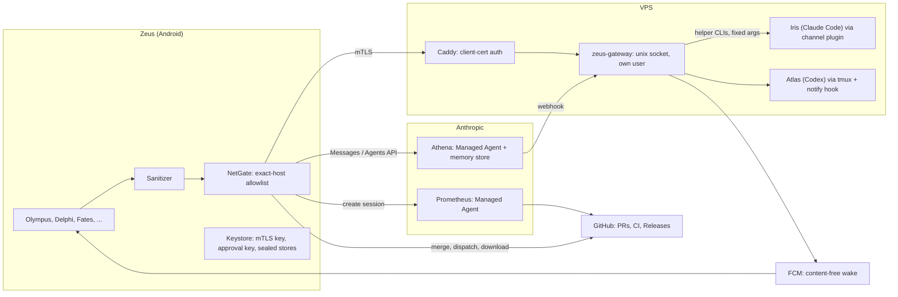

# Zeus

[](https://github.com/saiharsha03/zeus-showcase/actions/workflows/ci.yml)
[](https://github.com/saiharsha03/zeus-showcase/actions/workflows/server.yml)
[](https://github.com/saiharsha03/zeus-showcase/actions/workflows/codeql.yml)
[](https://github.com/saiharsha03/zeus-showcase/releases/latest)

A personal Android assistant and control center for a single owner, plus the small server it talks to. Built by Harsha.

This repository is a public showcase copy of a private app. Personal data, hosts, accounts and keys were replaced with
placeholders and synthetic fixtures; the architecture, security model, tests and CI/CD are the real ones. It is meant
to be read, not installed as-is: it expects your own VPS, Firebase project and API keys.

- Kotlin, Jetpack Compose, minSdk 31, target/compile SDK 35, arm64.
- On-device models: EmbeddingGemma (MediaPipe) for search, Gemini Nano and ML Kit OCR.
- Cloud brain: Anthropic API (direct Messages API chat) and **Athena**, a Claude Managed Agent with a memory store.
- Server: `zeus-gateway`, a FastAPI service on a VPS behind Caddy with mTLS, plus a Claude Code channel plugin.
- A Wear OS tile in `wear/`.
- Package id `dev.phonerecall` (inherited from an earlier app).

## Names

Every screen has a Greek or Roman name, a plain name and a one-line motto (`ui/Names.kt`). Settings has a **Plain
names** switch that shows the ordinary words instead. Search matches the Greek name, the plain name and the meaning.

- **Zeus** is the app; **Athena** is its brain.
- Workers on the VPS: **Iris** (Claude Code: mail, calendar, admin, the owner's ledger database), **Atlas** (Codex:
  server and code), **Echo** (phone calls).
- Athena's circle (child threads, same budget): **Odysseus** (long jobs), **Perseus** (research), **Atalanta**
  (watchers), **Diomedes** (errands), **Arachne** (drafting), **Annabeth** (strategy), with **Metis** as advisor. They
  report back and can execute nothing; any action becomes a proposal.

## Feature tour

One folder per feature under `app/src/main/java/dev/phonerecall/`.

**Home and daily life**
- **Olympus** · Home: adaptive, AI-ordered cards and a Now Bar.
- **Delphi** · Ask Athena: direct chat, with proposals inline.
- **Chronos** · Calendar: curated calendar with holidays, birthdays, out-of-office and availability.
- **Praxis** · Tasks: GTD-style clarify, contexts, waiting-for with check-backs, weekly review.
- **Venus** · Closet: outfit of the day from rules, weather and calendar; packing lists.
- **Eos** · Morning brief: one notification and one card before the day starts.
- **Hypnos** · Bedtime: alarm awareness, bedtime nudge, alarm intent.
- **Horae** · Rhythms: learned app and call habits, a call-home nudge for contacts in another time zone.
- **Kairos** · Moments: cooking timers from a photo of the box, parking, leaving home, flyers to events, tracking numbers.
- **Harmonia** · People: priority tiers and relationships, on-device only.
- **Parnassus** · Rambler: one capture box (text, voice, photo, share) that files items into sections.
- **Janus** · Two clocks: home and a second time zone in every context.

**Places, travel and the world**
- **Odyssey** · Places: visit timeline, automatic store places, commute and traffic, driving report, car log.
- **Argo** · Trips: trips assembled from calendar, bookings and chat; connections merged; travel-day live update.
- **Aeolia** · Weather: a WebView weather app with illustrated animated scenes, radar and snow bands. It can also use a
  Samsung Weather scene pack, which is third-party art and local-only (`assets/aeolia/samsung/`, git-ignored, not in this repo).
- **Olympia** · Sports: live scores (soccer, NFL, cricket, F1) as one live update.
- **Hestia** · Devices: lights and plugs through the Google Home APIs, proposal-only.
- **Music** · Spotify App Remote: context playlists, drive music, skip learning.

**Agents and the server**
- **Pantheon** · Agents: chat with Iris, Atlas and the group; slash commands into an agent's terminal after a confirm.
- **Agora** · Agent room: where Iris, Atlas and Athena coordinate; the owner reads and can steer.
- **Lemnos** · VPS: terminal (xterm.js), files, services, server power control, remote desktop (native RFB viewer).
- **Cerberus** · Alerts: security and service alerts from the VPS, with ack.
- **Metron** · Usage: plan usage windows for the agents and Athena's spend, with alerts.
- **Horologion** · Schedules: one inventory of every job, skill, hook and setting, by owner.
- **Clio** · Logs: sanitized on-device logs, 14 days, export.
- **Hermes** · Instant commands: open apps, alarms, timers, torch, DND, call/text, navigate, without a model call.

**Mind, memory and safety**
- **Fates** · Proposals: nothing moves without the owner. Tiered proposals, attention budget, auto-approve list, ledger.
- **Alexandria** · Memory: on-device retrieval (vectors plus FTS, with citations) over photos, screenshots, PDFs, notes.
- **Oneiroi** · Memory care: fact rows with supersede chains, a nightly "dream" consolidation, a subconscious sweep.
- **Theogony** · Getting to know you: a first-run seed from Iris and the phone, then a gap interview.
- **Lethe** · Expired: stale and seasonal items closed with a reason and an Undo.
- **Calypso** · Vault: fingerprint vault. The *Sealed* shelf is readable only by the owner (agents can only drop items
  in); the *Shielded* shelf (Aegis) is hidden from people but usable by agents.
- **Mnemosyne** · Backup: nightly encrypted backup through the gateway; restore with a 24-word recovery phrase.
- **Prometheus** · Improve the app: a managed agent that opens PRs against this repo (see below).

**Money and health**
- **Moneta** · Money: one row per purchase from bank notifications matched with the agent's ledger; fraud flags that ask.
- **Iaso** · Health: Health Connect, food photo log, weight trend, watch tile.

**Setup and surfaces**
- **Telete** · Setup: every permission and check with its reason and a button to the exact settings screen.
- **Themis** · Settings: grouped sections with search by words, synonyms and meaning.
- Eleven home-screen widgets, push-to-talk voice (on-device commands plus Gemini Live), default-assistant entry, and
  a dozen easter eggs (`docs/EASTER-EGGS.md`, spoilers).

## Architecture



- **Phone and Athena.** The phone sends Athena derived, sanitized notes and receives proposals. She never sees raw
  mail, location trails, health data or amounts.
- **Phone and gateway.** Only through Caddy with client-certificate auth; the gateway listens on a unix socket only.
  Routes cover health, terminal, files, services, agent chat and jobs, alerts, vault drops, backups, usage, money ops,
  trip info and Prometheus requests. `docs/ZEUS-GATEWAY.md` is the contract.
- **FCM.** Wake-ups carry no content (`{"t":"sync"}`): the phone wakes, then fetches from the gateway.
- **Hub rule.** Everything an agent does is visible and steerable in the app: schedules in Horologion, talk in
  Agora, logs in Clio.

## Security and privacy design

- **NetGate** (`brain/NetGate.kt`) is the one door to the internet: https/wss on 443 to an exact host list. Everything
  else is blocked and logged. `network_security_config.xml` is a second layer: no cleartext, no extra trust anchors.
- **Sanitizer** (`mind/Sanitizer.kt`) sits between the phone and any model. Never out: vault content, raw
  notifications, coordinates, health, money amounts, contact names, phone numbers, emails. Only derived facts leave.
- **Keystore sealing.** Vault, trips, money and people data are sealed with Keystore keys; the vault's private key
  needs a fresh fingerprint. Secret screens use FLAG_SECURE.
- **mTLS identity.** An EC P-256 device certificate, checked by fingerprint at the gateway. There is no bearer token.
- **Approval tokens.** An Ed25519 key signs `zt1` tokens after a biometric prompt, binding job id, kind, executor and
  payload hash; 15-minute expiry, single use. An unsigned job is only a suggestion.
- **Fates tiers.** 1: Athena's own space (automatic, logged, undoable). 2: on the phone, reversible. 3: outward or
  hard to undo. 4: critical, fingerprint. Money, messages, deletes and the server are never automatic.
- **Calypso drops.** Agents seal items to the vault's public key (`server/gateway/calypso.py`) and keep no plaintext.
- **Agent safety.** Quoted mail and web text is data, never instructions; trust-marker lookalikes are defused before
  Athena reads a post; Agora has a runaway guard.
- **Known limit.** If the agents' server user keeps passwordless sudo, the gateway's user split is not yet a hard
  boundary.

## CI/CD

All workflows pin every action to a full commit SHA (with the version in a comment), set `permissions: {}` at the top
and grant each job only what it needs, and use a concurrency group per ref.

| Workflow | Runs on | What it does |
|---|---|---|
| `ci.yml` | pull requests, `main` | Builds the debug APK and runs the unit tests (`assembleDebug testDebugUnitTest`), writes a pass/fail table to the job summary, uploads the test reports and the APK. A second job runs Android lint and publishes its report (report-only for now). |
| `server.yml` | changes under `server/` | Installs `server/requirements.txt` on Python 3.12 (Linux) and runs the gateway's pytest suite, with a job summary and JUnit results. |
| `codeql.yml` | pull requests, `main`, weekly | CodeQL `security-and-quality` for Kotlin/Java (traced Gradle build), Python and the workflows themselves. |
| `release.yml` | `v*` tags | Builds and tests, re-signs the APK with a throwaway key generated inside the job (deleted after use), checks the signature, and publishes a GitHub Release with `zeus-demo-<tag>.apk`, its SHA-256 and generated notes. |
| `dependabot.yml` | weekly | Update PRs for Gradle, pip (`server/`) and GitHub Actions, grouped. |

No workflow needs a repository secret. To cut a demo release: bump `versionName`/`versionCode` in
`app/build.gradle.kts`, then `git tag v2.0.1 && git push origin v2.0.1`.

The demo APK is for trying the app. It is not signed with the owner's key, so it can't update a real install, and the
placeholders (Firebase, gateway host) are not filled in.

### Prometheus: the self-update agent

`prometheus/` and `docs/PROMETHEUS.md` describe how the private app updates itself. From the phone you describe a bug;
the phone creates a Claude Managed Agent session with the repo mounted, a per-request budget and GitHub-only
networking. The agent works on `prometheus/<id>`, bumps the version and opens a PR; CI tests it. After a fingerprint,
the phone merges the exact tested head and dispatches a release workflow with a separate phone-only token. It accepts
the Release only if `github-actions[bot]` published it for that merge commit, the asset digest matches, and the APK's
signer matches the installed app; Android's installer asks for a final confirm. Prometheus's own token has no Actions
or Workflows permission, so it can't release or change workflows. That release workflow signs with the owner's key and
lives only in the private repo; this repo's `release.yml` is the public, throwaway-key equivalent.

## Build

Requirements: JDK 17+ (Android Studio's JBR works), the Android SDK, and a `local.properties` with `sdk.dir`.

```sh
echo "sdk.dir=$ANDROID_HOME" > local.properties
./gradlew assembleDebug testDebugUnitTest
```

Before a real install, replace the placeholders:
- `app/src/main/res/values/firebase.xml`: your Firebase project's API key, app id, project id and sender id (used only
  for FCM wake-ups; builds and tests work with the placeholders).
- `brain/NetGate.kt` and `res/xml/network_security_config.xml`: your gateway host instead of `zeus.example.com`.
- Spotify client id (`docs/SPOTIFY.md`), Google Home OAuth client (`docs/HESTIA.md`), and in `prometheus/` the
  `your-github-user/zeus` repository slug.
- API keys are entered on the phone and sealed in the vault; none live in the repo.

Pairing a phone with the gateway: in Lemnos tap *Make the keys*, run `python tools/pair_zeus.py <adb-serial>` (set
`ZEUS_VPS` and `ZEUS_SSH_KEY`; nothing secret crosses adb), then *Finish pairing*.

## Server

Code is in `server/`: `gateway/` (FastAPI app), `lib/`, `bin/` (helper CLIs run with fixed arguments), `hooks/`,
`plugin/` (Claude Code channel plugin for Iris), `deploy/` and `tests/`. On a Linux VPS, as root, from the unpacked tree:

```sh
bash deploy/install.sh                                      # user zeus, dirs, sudoers, Caddy block, systemd unit
/opt/zeus/venv/bin/python /opt/zeus/deploy/check.py         # end-to-end checks, exit 0 only if all pass
python -m pytest server/tests                               # gateway tests (Linux; uses fcntl/pwd)
```

`server/docs/` holds the protocol notes the VPS agents are given (trip info, morning brief, money log, first-run seed).

## Testing

- **Unit tests** (`app/src/test`, JUnit with Robolectric): `./gradlew testDebugUnitTest`. Fixtures are synthetic.
- **Shots**: Robolectric renders Compose previews to PNG under `app/build/shots` (`*Shots.kt`, `*Previews.kt`).
- **Telete self-tests**: safe on-device checks that log results to Clio.
- **Server**: `pytest server/tests`, then `deploy/check.py` on the VPS.

## Docs

`docs/ZEUS-GATEWAY.md` (server contract), `docs/PROMETHEUS.md`, `ARGO.md`, `BRIEF.md`, `HESTIA.md`, `HORAE.md`,
`MNEMOSYNE.md`, `MODELS.md`, `MOMENTS.md`, `SPOTIFY.md`, `VOICE.md`, `EASTER-EGGS.md`, and `server/docs/`.

## Third-party code

No third-party SDK binaries are committed. The Spotify App Remote AAR is downloaded at build time from Spotify's
official GitHub release and checked against a pinned SHA-256 (`app/build.gradle.kts`). The Google Home APIs SDK is not
on a public Maven: without it, the build compiles a stub Hestia backend (`app/src/homeStub`); to build the real one, put
Google's SDK in `app/libs/home-sdk` as described in `docs/HESTIA.md`. `app/src/main/assets/` includes xterm.js (MIT), SunCalc (BSD-2) and the Space Grotesk and Geist Mono fonts (SIL OFL 1.1,
full license texts alongside), listed in `aeolia/third-party-notices.txt` and `lemnos/NOTICE.txt`. The app and coin art
was generated for this project.

## License

No license has been chosen yet, so all rights are reserved by default.
